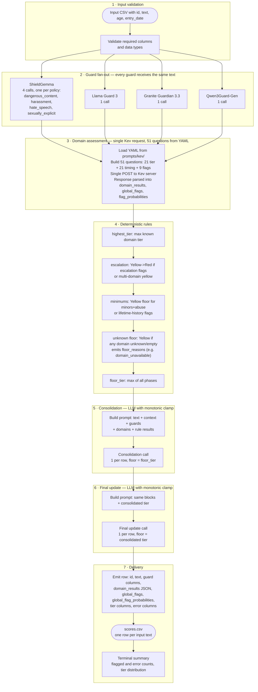

# Data Flow

Text enters one row at a time. Each row is independently scored: guard fan-out, one
Kev decision-model request (51 questions from YAML), deterministic rule phases,
then two LLM consolidation steps. Nothing aborts on failure — every input row
produces an output row.

## Flow

## Notes

- **10 calls per entry.** Guards contribute 7 (ShieldGemma = 4). Kev domain
  assessment contributes 1 (single request bundling 51 questions). Consolidation
  and final update add 2 more. Retries on transient failures add further calls.
- **Failures are data, not exceptions.** A guard that cannot be parsed writes its
  message to its `*_error` column. A Kev request failure marks all domains as
  `unknown` (all-or-nothing: there is no partial-domain fallback). Consolidation
  and final-update failures fall back to the floor tier. The row is always emitted.
- **14-day cross-entry rule is downstream.** The pipeline processes entries
  independently. The rubric rule "same domain rated Yellow in 2+ entries within
  14 days escalates to Red" must be applied after the pipeline, across all rows
  for a given participant.
- **Monotonic clamp.** Both consolidation and final update enforce monotonicity:
  the LLM may raise the tier above the floor but never lower it. If the LLM
  proposes a lower tier, the floor is used instead.
- **Order of operations per row** is strictly serial: all guards are queried
  before Kev domain assessment begins; Kev completes before deterministic rules
  run; deterministic rules complete before consolidation; consolidation completes
  before final update.
- **highest_domain_tier uses enum ordering.** Tier comparison uses the enum order green(0) < yellow(1) < red(2), not alphabetical string ordering. When no domains return a known tier, the column is `unknown`.
- **domain_incomplete is honored from the Kev stage.** If the Kev stage fails or returns empty results, `domain_incomplete` is set to true before deterministic rules run. The unknown-floor phase then raises to Yellow.
- **Three canonical tiers.** The system uses `green`, `yellow`, `red`. A legacy
  column `final_risk` maps to `no_low_risk`, `concerning`, `high_risk` for
  backward compatibility.
- **YAML is the runtime source.** Domain questions are defined in YAML files under
  `prompts/kev/` (`_shared.yaml` + 21 domain files). There is no compilation or
  prompt-generation step — YAML is loaded and validated at runtime.
- **Kev produces no free-text evidence.** The `domain_results` JSON contains
  tier, timing, scores, probabilities, and confidence fields. Global flags are
  emitted separately in `global_flags` and `global_flag_probabilities` columns.
- **Kev confidence is calibrated model output.** The `tier_confidence` and
  `timing_confidence` fields report the model's calibrated confidence. These are
  not externally measured accuracy scores.
