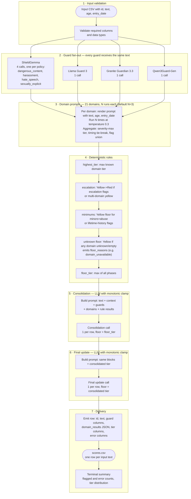

# Data Flow

Text enters one row at a time. Each row is independently scored: guard fan-out, 21
domain prompts (3 runs each), deterministic rule phases, then two LLM consolidation
steps. Nothing aborts on failure — every input row produces an output row.

## Flow

## Notes

- **72 calls per entry at defaults.** Guards contribute 7 (ShieldGemma = 4). Domain
  prompts contribute 63 (21 domains × 3 runs). Consolidation and final update add
  2 more. Retries on parse failure add further calls.
- **Failures are data, not exceptions.** A guard that cannot be parsed writes its
  message to its `*_error` column. A domain-prompt run failure is recorded in
  `custom_prompt_errors` and leaves that domain as `unknown`. Consolidation and
  final-update failures fall back to the floor tier. The row is always emitted.
- **14-day cross-entry rule is downstream.** The pipeline processes entries
  independently. The rubric rule "same domain rated Yellow in 2+ entries within
  14 days escalates to Red" must be applied after the pipeline, across all rows
  for a given participant.
- **Monotonic clamp.** Both consolidation and final update enforce monotonicity:
  the LLM may raise the tier above the floor but never lower it. If the LLM
  proposes a lower tier, the floor is used instead.
- **Order of operations per row** is strictly serial: all guards are queried
  before domain prompts begin; domain prompts complete before deterministic rules
  run; deterministic rules complete before consolidation; consolidation completes
  before final update.
- **highest_domain_tier uses enum ordering.** Tier comparison uses the enum order green(0) < yellow(1) < red(2), not alphabetical string ordering. When no domains return a known tier, the column is `unknown`.
- **domain_incomplete is honored from the custom-prompt stage.** If the custom-prompt stage fails or returns empty results, `domain_incomplete` is set to true before deterministic rules run. The unknown-floor phase then raises to Yellow.
- **Three canonical tiers.** The system uses `green`, `yellow`, `red`. A legacy
  column `final_risk` maps to `no_low_risk`, `concerning`, `high_risk` for
  backward compatibility.
